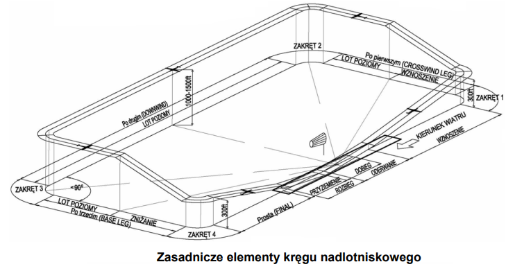

# Krąg nadlotniskowy

Krąg nadlotniskowy (_ang. aerodrome traffic circuit, traffic pattern_) to standardowa, ustalona trasa lotu wokół lotniska, którą wykonują statki powietrzne podczas przygotowania do lądowania lub po starcie, gdy pozostają w rejonie lotniska (np. loty szkolne, ćwiczenie lądowań). 

Źródło: Okólnik doradczy ULC 6.08.2010

Głównym zadaniem kręgu nadlotniskowego jest uporządkowanie ruchu w rejonie lotniska.

obsluga ruchu w kregu
traffic info (radarowe/nieradarowe)
praktyczne sugestie - lepiej oczekiwanie w downwindzie niz wydluzanie prostej

krag krotki/niski/dwuzakretowy

### krąg niestandardowy
babice, okęcie

### Operacje na pasie

low pass/low approach/touch and go/full stop/stop and go
low pass szybszy niz konwojer

opcja - oznacza kazde z powyzszych, uzywac z rozwaga
imitacje - 

### Wlot i wylot z CTR

## Separacja z innym ruchem

## Zmiana zasad lotu

## typowe operacje

strefa, kręgi, imitacje

## Niestandardowe operacje

base training

hems - odnośnik do odpowiedniego artykułu

## AFIS

podstawowe roznice, frazeologia fis, informacja o ruchu, nie wydaje sie instrukcji i zezwolen a jedynie sugeruje